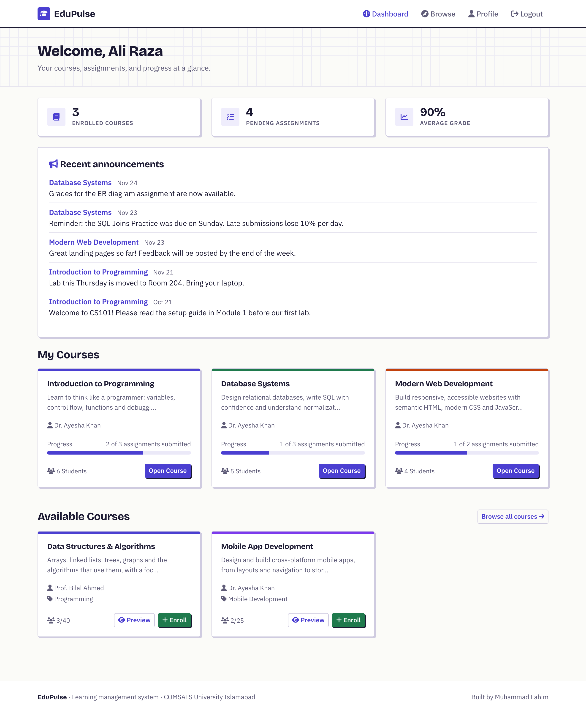
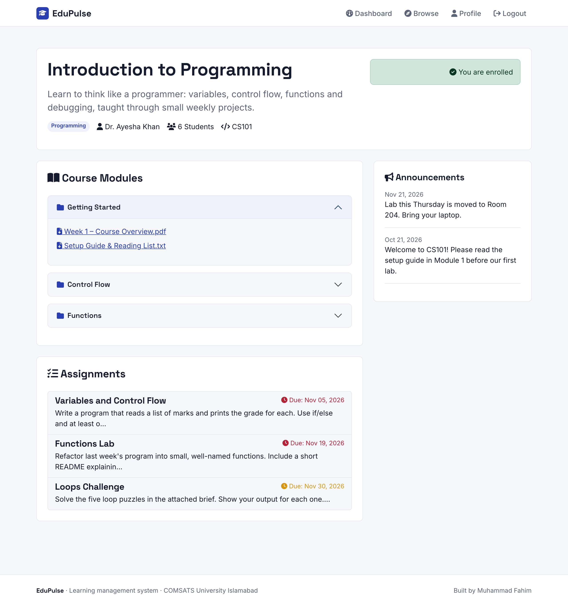
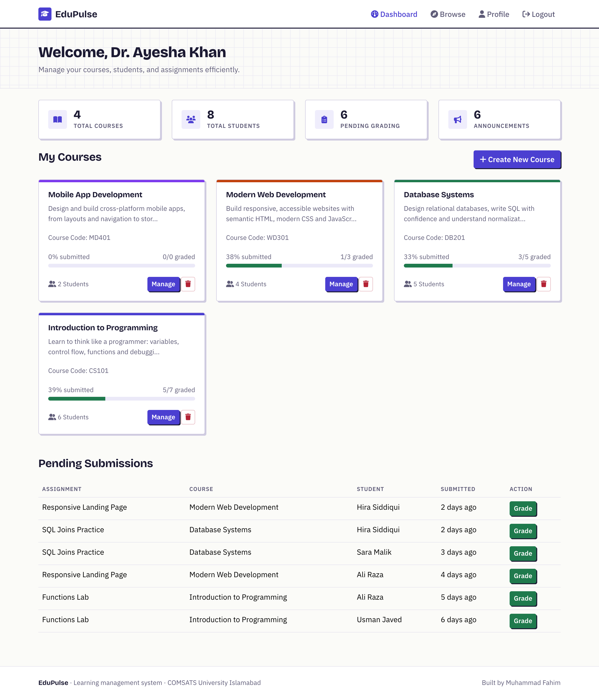
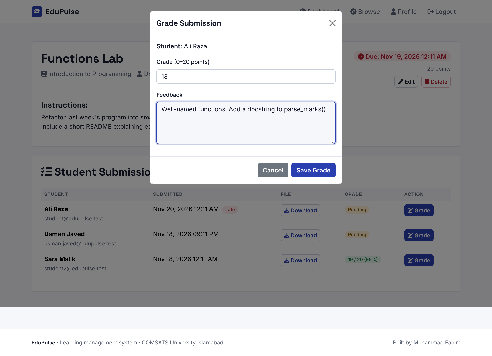
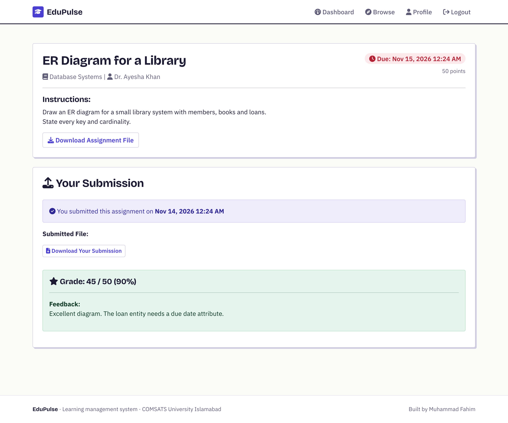
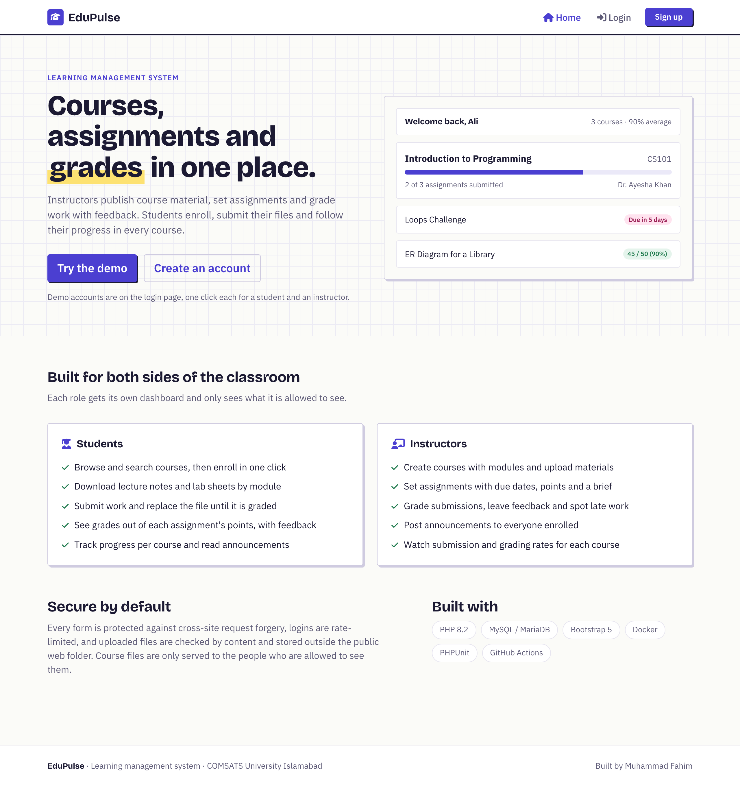
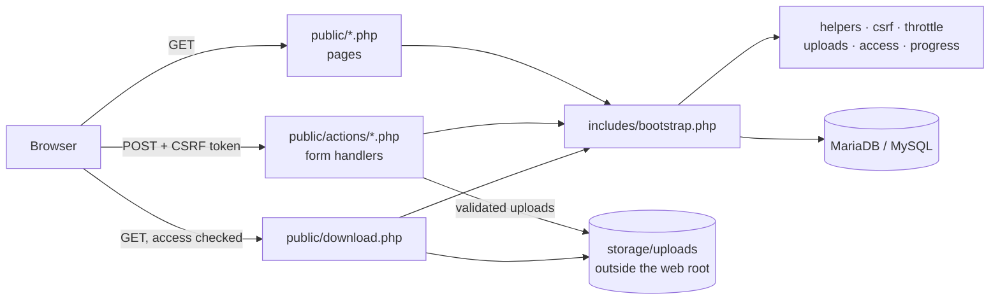
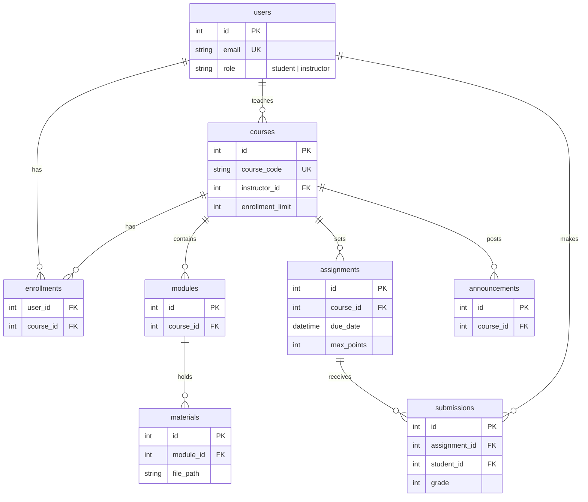

# EduPulse

A learning management system for instructors and students, built with plain PHP and MySQL.

[](https://github.com/mfahim-dev/EduPulse/actions/workflows/ci.yml)

Instructors create courses, upload materials, set assignments and grade submissions with feedback. Students enroll, hand in their work and follow their progress in every course. It started as a semester project at COMSATS University Islamabad and was later rebuilt for security, tests and a cleaner interface.

## Features

**Students**
- Browse and search the course catalogue by name, code or category, then enroll in one click
- Download lecture notes and lab sheets, organised by module
- Submit work, and replace the file until it has been graded
- See grades out of each assignment's points (for example "45 / 50 (90%)") along with written feedback
- Follow progress per course, see late submissions flagged, and read course announcements

**Instructors**
- Create, edit and delete courses, modules and course materials
- Set assignments with a due date, maximum points and an optional brief
- Grade submissions with feedback; late work is marked automatically
- Post and remove announcements for everyone enrolled
- See submission and grading rates for each course at a glance

## Screenshots

| Student dashboard | Course page |
|---|---|
|  |  |
| **Instructor dashboard** | **Grading a submission** |
|  |  |
| **Graded assignment** | **Landing page** |
|  |  |

The layout also works on phones: [mobile dashboard](docs/screenshots/07-mobile-dashboard.png).

## Run it locally

You need Docker with Docker Compose.

```bash
git clone https://github.com/mfahim-dev/EduPulse.git
cd EduPulse
cp .env.example .env
docker compose up -d
```

Open http://localhost:8080. On first start the database is created and filled with demo data. Use the buttons on the login page, or sign in with:

| Role | Email | Password |
|---|---|---|
| Instructor | `instructor@edupulse.test` | `Instructor123!` |
| Student | `student@edupulse.test` | `Student123!` |

To reset everything to the demo data: `docker compose exec app php database/seed.php`

<details>
<summary>Running it with XAMPP instead</summary>

1. Copy the project into `htdocs/` and copy `.env.example` to `.env`.
2. In `.env`, set `DB_HOST=127.0.0.1` and the credentials of a MySQL user that can create tables in a new `edupulse` database.
3. Create the schema and demo data: `php database/seed.php`
4. Open http://localhost/EduPulse/. The root `.htaccess` sends visitors to `public/` and blocks everything else. Pointing Apache's document root at `public/` is better still.

</details>

## Tests

```bash
docker compose exec app composer install
docker compose exec app vendor/bin/phpunit
```

There are 133 tests in three suites: unit tests for the helpers, integration tests against the database, and HTTP tests that drive the real app through Apache (logins, permissions, uploads, grading). Running the suite resets the local database to the demo data. GitHub Actions runs the lint and the full suite on every push.

## Architecture

Every page in `public/` is a plain PHP script. Forms post to small handlers in `public/actions/`. Both load one shared file, `includes/bootstrap.php`, which reads the configuration, opens the database connection, starts a hardened session and loads the helper modules.



```
public/            web root: pages, actions/, download.php, assets/
includes/          bootstrap, helpers and shared layout partials
config/            .env loader and PDO connection
database/          schema.sql, seeder and sample files
storage/uploads/   private course files and submissions
tests/             Unit, Integration and Http suites
docker/            PHP + Apache image
scripts/           screenshot and layout-check helper
```

### Database



Every foreign key cascades on delete. Unique keys stop duplicate emails, course codes, enrollments and submissions. A separate `login_attempts` table backs the login rate limit.

## Security notes

The original semester version had several gaps. This is what was fixed and why:

- **No secrets in the repository.** Database credentials come from environment variables or a git-ignored `.env`. A password committed in the original history has been scrubbed from it.
- **CSRF protection.** Every form carries a per-session token that is checked before any action runs. Logout is a POST, so a link on another site can't log you out.
- **Hardened sessions.** Cookies are `HttpOnly` and `SameSite=Lax`, and the session ID is regenerated on login to stop session fixation.
- **Login abuse.** One generic "Invalid email or password." message means attackers can't tell which emails have accounts. Five failed attempts lock that email and IP pair for 15 minutes.
- **Safe uploads.** Files are checked by extension and by their actual content, and stored under random names. Course files and submissions live outside the web root and are streamed by `download.php` only to the course owner, enrolled students or the student who submitted. Script execution is disabled in the public upload folder.
- **Authorization on every action.** Instructors can only change their own courses. A grade can only be written to a submission that belongs to the assignment being graded. Students can only submit to courses they are enrolled in.
- **No leaked internals.** Database errors are logged, and visitors see a friendly error page (set `APP_ENV=local` in `.env` to see details while developing). Only `public/` is reachable over HTTP, including in the XAMPP layout, which has its own tests. Responses send `nosniff`, `Referrer-Policy` and frame-ancestor headers.

## Tech stack

PHP 8.2 · MySQL / MariaDB · Bootstrap 5.3 · vanilla JavaScript · Docker Compose · PHPUnit 11 · GitHub Actions · Playwright (screenshots only)

## Author

Built and maintained by **Muhammad Fahim**. EduPulse started as a semester project at COMSATS University Islamabad and was later rebuilt with a hardened security layer, a test suite with CI, a Docker setup and a new interface.

## License

All rights reserved. The code is published to show the work; please ask before reusing it.
